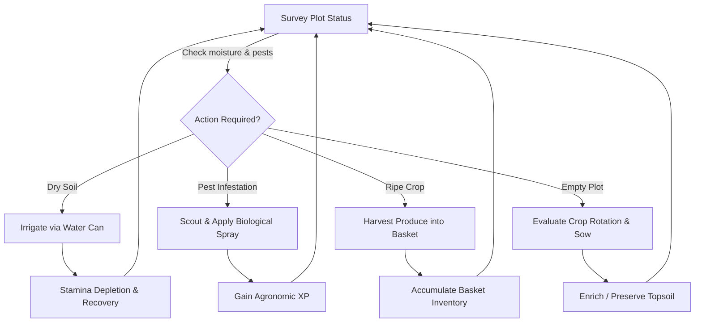

# FieldShift 360: Game Design Document (GDD)
**Project**: FieldShift 360 — Interactive Agro-Climatic Simulation & Educational Gaming Suite  
**Titles**: "মাঠের মানুষ" (Field Folk 3D), "দশ বছরের উত্তরাধিকার" (The Ten-Year Inheritance Saga), "স্বপ্নের মাঠ" (The Dream Field)  
**Target Platforms**: Progressive Web App (Mobile/Desktop WebGL, WebXR AR/VR)  
**Target Audiences**: Bangladeshi smallholder farmers, Sub-Assistant Agriculture Officers (SAAOs), youth, students, and global climate learners.

---

## 1. Executive Summary & Game Vision

### 1.1 The High Concept
FieldShift 360 transforms empirical NASA Earth Observation records (MODIS, SMAP, GPM IMERG, GRACE-FO) and IPCC/FAO agronomic science into an engaging, empathetic, third-person 3D agricultural simulation. Players step into the sandals of real farming archetypes across South Asia—facing real climate hazards, experiencing genuine soil microbiome tradeoffs, and internalizing sustainable crop rotation principles through experiential gameplay.

### 1.2 Core Pillars
1. **Empirical Ground-Truth (Fact Over Fiction)**: Sample people with authentic cultural garments and lived struggles; 100% genuine climate series, satellite observations, and soil properties.
2. **Pedagogical Empathy**: Decision consequences are felt directly (heat exhaustion, topsoil stripping in cyclonic downpours, pest swarms after monoculture repeats).
3. **Universal Accessibility**: Sub-500 KB initial payload, zero external audio/texture downloads, procedural WebGL base meshes, procedural Web Audio ragas, and full responsive operation down to \$50 Android smartphones.
4. **Bilingual Parity**: Native Bangla-first narration paired with complete English internationalization (`T(bn, en)` / `L({ bn, en })`).

---

## 2. Core Gameplay Loops

### 2.1 The Micro Loop (Moment-to-Moment: 5–30 Seconds)

### 2.2 The Meso Loop (Day-to-Day: 1–3 Minutes)
- **Morning (06:00–12:00)**: Field assessment, refilling water can at tube well/pond, purchasing certified seed from village shed.
- **Midday (12:00–16:00)**: Handling extreme evaporative stress, monitoring heatwave alerts, consulting FieldShift satellite kiosk.
- **Evening (16:00–18:30)**: Carrying harvested yield to wholesale marketplace (*haat*), avoiding sudden price gluts, banking revenue.
- **Night (18:30–06:00)**: Recovery phase, reflecting on daily soil organic matter gains and weather forecast warnings.

### 2.3 The Macro Loop (Season-to-Season: 5–10 Minutes)
- **Season Onset**: Sowing decision based on IMERG monsoon onset radar and soil moisture.
- **Mid-Season Hazard Survival**: Navigating convective storms (reaching shelter circle), managing pest waves triggered by regional monocultures.
- **Season Closure & Evaluation**: Comprehensive Agricultural Scorecard evaluating Soil Stewardship, Water Conservation, Crop Diversity, and Economic Margin; unlocking next-season What-If climate sliders ($+2^\circ\text{C}$ temperature, $-10\%$ precipitation).

---

## 3. Comparative Game Study & Pedagogical Positioning

| Dimension | Stardew Valley | Farming Simulator | Civilization VI | **FieldShift 360 (Field Folk 3D)** |
| :--- | :--- | :--- | :--- | :--- |
| **Pacing** | Relaxing, cozy fantasy | Methodical, industrial machinery | Turn-based macro strategy | Tense, agile, real-time survival & agro-climatic balance |
| **Agronomic Realism** | Fantasy crops, static seasons | Machine physics & yield tonnes | Abstract hex yields ($+2$ Food) | FAO-56 dual crop coefficient, ICBM carbon balances, IPM biological feedbacks |
| **Climate Hazard** | Predictable rain days | Minor hail/weather toggle | Disconnected tile disasters | Real GPM IMERG rainfall, SMAP root stress, cyclonic storm evasion |
| **Socio-Economic Focus** | Western homestead / town life | Large corporate agribusiness | Imperial expansion & statehood | Smallholder subsistence, cashflow friction, haat market gluts |
| **Hardware Barrier** | Requires standalone GPU / app | High-spec PC / console | High CPU / memory requirements | Runs in any mobile browser with 0 asset downloads |

---

## 4. Characters & Regional Archetypes

### 4.1 The 12 Playable Farmers
1. **Razib Miah** (*Dhamrai, Dhaka, Bangladesh*): Alluvial loam; potato, mustard, boro rice; faces intense pre-monsoon Kalbaishakhi squalls.
2. **Rahim Uddin** (*Godagari, Rajshahi, Bangladesh*): Barind tract red clay; lentil, chickpea, mango, wheat; high drought & groundwater drawdown.
3. **Md. Didarul Alam** (*Sitakunda, Chattogram, Bangladesh*): Coastal piedmont; country bean, bitter gourd; cyclonic marine depressions.
4. **Prahlad Chandra Roy** (*Dacope, Khulna, Bangladesh*): Coastal saline delta; saline-tolerant aman, sunflower, watermelon; tidal storm surges.
5. **Abdul Kader Howlader** (*Bakerganj, Barishal, Bangladesh*): Tidal floodplain; khesari pulse, betel leaf; waterlogging & riverbank spates.
6. **Md. Mofizul Islam** (*Gangachara, Rangpur, Bangladesh*): Teesta sandy charland; sweet pumpkin, maize, tobacco; cold wave rot.
7. **Rahima Begum** (*Gowainghat, Sylhet, Bangladesh*): Haor depression basin; boro paddy, mustard; early flash floods.
8. **Harjinder Singh** (*Punjab, India*): Canal irrigated Indo-Gangetic plains; basmati, wheat, mustard; tubewell depletion and stubble management.
9. **Ghulam Nabi Chandio** (*Sindh, Pakistan*): Lower Indus canal basin; cotton, chickpea; extreme saline heat and irrigation rationing.
10. **Rampyari Chaudhary** (*Terai, Nepal*): Sub-Himalayan fertile plains; lentil, mustard; mountain runoff and shifting wet spells.
11. **Kinley Wangmo** (*Punakha, Bhutan*): Himalayan mountain valleys; red rice, buckwheat; cold mountain winds and slope erosion.
12. **U Kyaw Win** (*Ayeyarwady Delta, Myanmar*): Lowland tropical delta; sesame, black gram; monsoon storm inundation.

---

## 5. Educational Pedagogy & Learning Objectives

1. **Nitrogen Replenishment via Legumes**: Experiencing $+0.35$ fertility jump and $+25\text{ XP}$ upon harvesting lentils or chickpeas demonstrates how biological nitrogen fixation slashes synthetic urea costs.
2. **Pest Cycle Disruption through Crop Rotation**: Players visually encounter how monoculture repetition directly causes pest waves on adjacent plots, while rotation starves pest populations naturally.
3. **Topsoil Conservation via Cover & Mulch**: Experiencing storm-induced fertility stripping on bare plots cements the critical necessity of organic mulching and green cover.
4. **Water Stewardship under Climate Volatility**: Monitoring SMAP root-zone depletion prevents over-irrigation while safeguarding plants through thermal heatwaves.
