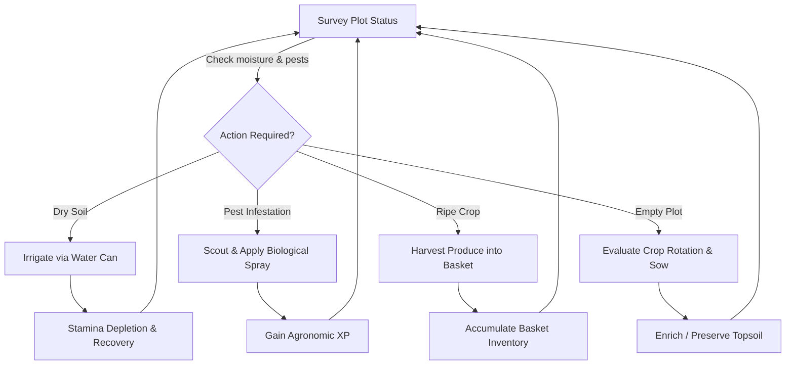

# FieldShift 360: Game Design Document (GDD)
**Project**: FieldShift 360 — Interactive Agro-Climatic Simulation & Educational Gaming Suite  
**Titles**: "মাঠের মানুষ" (Field Folk 3D), "দশ বছরের উত্তরাধিকার" (The Ten-Year Inheritance Saga), "স্বপ্নের মাঠ" (The Dream Field)  
**Target Platforms**: Progressive Web App (Mobile/Desktop WebGL, WebXR AR/VR)  
**Target Audiences**: Bangladeshi smallholder farmers, Sub-Assistant Agriculture Officers (SAAOs), youth, students, and global climate learners.

---

## 1. Executive Summary & Game Vision

### 1.1 The High Concept
Field Folk is a third-person 3D learning game about day-to-day farm decisions: planting, watering, protecting, harvesting, rotating crops, and selling at market. Its plot moisture, growth, pest, weather-event, and economy rules are designed game simulations, not field measurements or a live forecast. The in-game FieldShift station separately presents the app’s real satellite, climate, and water records for the farmer’s location, with their data labels. This separation lets players explore practical tradeoffs without mistaking a game outcome for advice or a prediction.

### 1.2 Core Pillars
1. **Clear provenance**: The game labels fictionalized/sample farmers and simulated plot outcomes; its FieldShift station identifies the real datasets it displays.
2. **Pedagogical Empathy**: Decision consequences are felt directly (heat exhaustion, topsoil stripping in cyclonic downpours, pest swarms after monoculture repeats).
3. **Universal Accessibility**: Lazy-load the game, generate scene elements and sound in code, and offer a light graphics mode for lower-powered devices. Validate performance on representative phones before promising a frame rate or device floor.
4. **Bilingual Parity**: Native Bangla-first narration paired with complete English internationalization (`T(bn, en)` / `L({ bn, en })`).

---

## 2. Core Gameplay Loops

### 2.1 The Micro Loop (Moment-to-Moment: 5–30 Seconds)

### 2.2 The Meso Loop (Day-to-Day: 1–3 Minutes)
- **Morning (06:00–12:00)**: Field assessment, refilling water can at tube well/pond, purchasing certified seed from village shed.
- **Midday (12:00–16:00)**: Handling extreme evaporative stress, monitoring heatwave alerts, consulting FieldShift satellite kiosk.
- **Evening (16:00–18:30)**: Carrying harvested yield to wholesale marketplace (*haat*), avoiding sudden price gluts, banking revenue.
- **Night (18:30–06:00)**: Recovery and review of the game’s soil indices and next scripted event.

### 2.3 The Macro Loop (Season-to-Season: 5–10 Minutes)
- **Season Onset**: Choose crops and consult the real local records in the FieldShift kiosk; the game map and plot moisture remain simulated.
- **Mid-Season Hazard Survival**: Practise responding to the game’s scripted storm and pest events, including reaching the shelter circle.
- **Season Closure & Evaluation**: Comprehensive Agricultural Scorecard evaluating Soil Stewardship, Water Conservation, Crop Diversity, and Economic Margin; unlocking next-season What-If climate sliders ($+2^\circ\text{C}$ temperature, $-10\%$ precipitation).

---

## 3. Comparative Game Study & Pedagogical Positioning

| Dimension | Stardew Valley | Farming Simulator | Civilization VI | **FieldShift 360 (Field Folk 3D)** |
| :--- | :--- | :--- | :--- | :--- |
| **Pacing** | Relaxing, cozy fantasy | Methodical, industrial machinery | Turn-based macro strategy | Tense, agile, real-time survival & agro-climatic balance |
| **Agronomic Realism** | Fantasy crops, static seasons | Machine physics & yield tonnes | Abstract hex yields ($+2$ Food) | Rule-based moisture, soil-index, crop-rotation, and pest systems (educational game model) |
| **Climate Hazard** | Predictable rain days | Minor hail/weather toggle | Disconnected tile disasters | Designed hazard events; real local records appear separately in the FieldShift station |
| **Socio-Economic Focus** | Western homestead / town life | Large corporate agribusiness | Imperial expansion & statehood | Smallholder subsistence, cashflow friction, haat market gluts |
| **Hardware Barrier** | Requires standalone GPU / app | High-spec PC / console | High CPU / memory requirements | Browser game with generated scene assets; performance varies by device |

---

## 4. Characters & Regional Archetypes

### 4.1 The 12 Playable Sample Characters

These fictionalized people are learning-game characters, not accounts of real farmers. Their regional settings draw on real places, crops, and hazards; the game’s plot outcomes remain simulated.

1. **Razib Miah** (*Dhamrai, Dhaka, Bangladesh*): Alluvial loam; potato, mustard, boro rice; faces intense pre-monsoon Kalbaishakhi squalls.
2. **Rahim Uddin** (*Godagari, Rajshahi, Bangladesh*): Barind tract red clay; lentil, chickpea, mango, wheat; high drought & groundwater drawdown.
3. **Md. Didarul Alam** (*Sitakunda, Chattogram, Bangladesh*): Coastal piedmont; country bean, bitter gourd; cyclonic marine depressions.
4. **Prahlad Chandra Roy** (*Dacope, Khulna, Bangladesh*): Coastal saline delta; saline-tolerant aman, sunflower, watermelon; tidal storm surges.
5. **Abdul Kader Howlader** (*Bakerganj, Barishal, Bangladesh*): Tidal floodplain; khesari pulse, betel leaf; waterlogging & riverbank spates.
6. **Md. Mofizul Islam** (*Gangachara, Rangpur, Bangladesh*): Teesta sandy charland; sweet pumpkin, maize, tobacco; cold wave rot.
7. **Rahima Begum** (*Gowainghat, Sylhet, Bangladesh*): Haor depression basin; boro paddy, mustard; early flash floods.
8. **Harjinder Singh** (*Punjab, India*): Canal irrigated Indo-Gangetic plains; basmati, wheat, mustard; tubewell depletion and stubble management.
9. **Ghulam Nabi Chandio** (*Sindh, Pakistan*): Lower Indus canal basin; cotton, chickpea; extreme saline heat and irrigation rationing.
10. **Rampyari Chaudhary** (*Terai, Nepal*): Sub-Himalayan fertile plains; lentil, mustard; mountain runoff and shifting wet spells.
11. **Kinley Wangmo** (*Punakha, Bhutan*): Himalayan mountain valleys; red rice, buckwheat; cold mountain winds and slope erosion.
12. **U Kyaw Win** (*Ayeyarwady Delta, Myanmar*): Lowland tropical delta; sesame, black gram; monsoon storm inundation.

---

## 5. Educational Pedagogy & Learning Objectives

1. **Legumes and soil learning**: Harvesting a pulse raises the game’s soil and carbon indices and awards XP. This introduces the role of legumes; it is not a modeled nutrient budget or a fertilizer-cost estimate.
2. **Pest Cycle Disruption through Crop Rotation**: Players see repeated crops attract more simulated pest pressure, while rotating crops reduces that pressure in the game.
3. **Topsoil conservation**: The game marks bare plots as eroded after a storm and teaches that soil cover can reduce erosion. This is a simplified rule, not a measured soil-loss estimate.
4. **Water stewardship under climate volatility**: The game’s simulated moisture layer gives players practice spotting dry plots during heat events. Real SMAP root-zone records appear separately in the FieldShift station and do not drive the game’s crop-growth rules.

